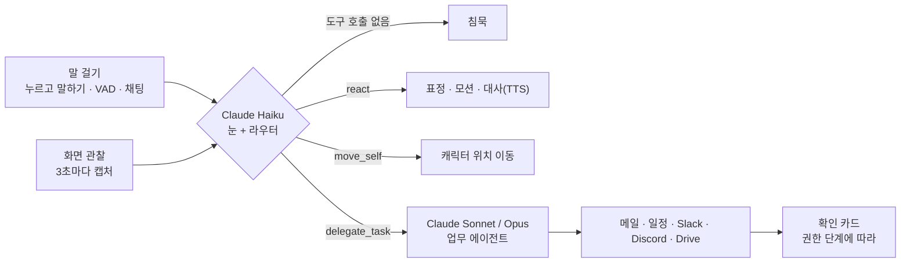

<p align="center">
  <a href="https://yuiyumi-seven.vercel.app"></a>
</p>

<h1 align="center">YuiYumi · 유이유미</h1>

<p align="center">
  <b>화면 옆에 사는 Live2D 캐릭터 비서</b><br>
  귀엽지만, 일은 똑 부러지게.
</p>

<p align="center">
  <a href="https://yuiyumi-seven.vercel.app"><b>웹 데모</b></a> ·
  <a href="https://yuiyumi.vercel.app">소개 페이지</a> ·
  <a href="docs/user-guide.md">사용 설명서</a> ·
  <a href="docs/spec.md">기획안</a>
</p>

<p align="center">
  
  
  
  
  
</p>

Bloom × Anthropic × Seoul AI Hub **Ambition for Korea 해커톤**(2026-10-24) · AttentionX 미션 "한국의 엔터·게임 감각으로 미국 Personal Agent와 경쟁하는 서비스" · Team 김&양(김유빈, 양하정)

화면 위에 상주하며 사용자가 하는 일을 보고 먼저 말을 걸고, 메일·일정 같은 업무를 대신 처리하는 Live2D 캐릭터 AI 비서다.

> 데스크톱 Chrome에서 여는 것을 권장한다. 첫 화면에서 캐릭터의 말풍선으로 언어와 부를 이름을 정하면 데모가 시작된다. 계정을 연결하지 않은 서비스의 메일·일정·메시지는 모두 가공 데이터다.

<p align="center">
  
</p>

## 왜 만들었나

일을 하는 AI는 곁에 두고 싶지 않고, 곁에 두고 싶은 AI는 일을 못 한다.

| | 업무형 Personal Agent | 캐릭터 컴패니언 앱 | **YuiYumi** |
|---|---|---|---|
| 화면 상주 | 부를 때만 | 앱 안에서만 | **항상 화면 옆에** |
| 먼저 말 걸기 | 없음 | 대화 앱 안에서 | **눈치 엔진의 규칙 안에서** |
| 실제 업무 | 가능 | 거의 없음 | **메일·일정·Slack·Discord·Drive** |
| 캐릭터 애착 | 낮음 | 높음 | **높음(Live2D·목소리·표정)** |
| 안전장치 | 제품마다 다름 | 해당 없음 | **확인 카드·지시문 차단** |

그 사이의 빈자리, 매일 켜 두고 싶으면서 일도 하는 동료를 노린다. 연애·성인 요소 없이 일 잘하는 같은 팀 동료로 설계했다. 첫 시장은 서브컬처·컴패니언 문화가 강한 일본·중국·대만이다.

## 미리 보기

<p align="center">
  
</p>
<p align="center"><sub>"정하은 님 메일에 오늘 15시로 미팅 가능하다고 답장 초안 써줘" — 초안을 쓰고, 보내기 전에 확인 카드로 묻는다.</sub></p>

<p align="center">
  
</p>

## 주요 기능

- **눈치껏 한마디**: 3초마다 화면을 캡처해 Claude Haiku가 상황을 판단하고, 필요할 때 먼저 말을 건다.
- **시키면 초안까지**: Claude 에이전트(기본 Sonnet, 설정에서 Opus 선택)가 메일 답장·발송, 일정 추가·삭제, 알림, Slack·Discord 게시, Drive 검색을 처리한다.
- **실계정 연동**: 사용자가 자기 Google(Gmail·Calendar)·Slack·Discord 계정을 OAuth로 연결하면 실제 계정에서 동작하고, 연결하지 않은 서비스는 가공 데이터로 동작한다(`docs/integrations-setup.md`).
- **음성**: 누르고 말하기(기본)와 VAD 입력, 채팅, Deepgram STT, 캐릭터별 ElevenLabs TTS와 립싱크.
- **캐릭터**: 유이(Yui)와 유미(Yumi) 두 캐릭터, 상황별 표정, 쓰다듬기·찌르기 반응, 편집 가능한 캐릭터 카드.
- **다국어**: English, 日本語, 한국어, 简体中文, 繁體中文(台灣). 표시 언어와 음성 언어를 따로 고른다.
- **macOS 데스크톱 앱**: 같은 프런트엔드를 Tauri로 감싼 투명 오버레이로, 실제 화면을 보고 바탕화면 위에 상주한다(`docs/desktop-app.md`).
- **로컬 에이전트 런타임**: 데스크톱 앱에서 파일·셸 작업을 맡는 Claude Agent SDK 기반 백엔드다(`docs/agent-runtime.md`).

## 작동 방식



1. **말을 건다.** 누르고 말하기, VAD, 채팅 중 편한 방법으로 말한다. 화면은 3초마다 함께 살펴본다.
2. **수다인지, 일인지 알아챈다.** 가벼운 말에는 Live2D 표정과 대사로, 업무는 작업 모델에 넘겨 도구로 처리한다.
3. **보내기 전엔 확인받는다.** 발송·게시는 확인 카드를 거치고, 창을 열고 입력하는 과정까지 화면에 보여 준다.

### 눈치 엔진

먼저 말을 거는 비서가 귀찮은 비서가 되지 않도록 결정적 규칙 게이트를 둔다(`src/nunchi/gate.ts`).

- 사용자가 말하는 중, 캐릭터가 말하는 중, 에이전트가 작업 중에는 먼저 말을 걸지 않는다.
- 캐릭터의 마지막 대사가 끝난 뒤 20초가 지나야 다시 말을 건다.
- 말할 만한 순간인지는 Haiku가 판단하고, 응답이 도착한 시점에 게이트를 한 번 더 확인한다.
- "조용히"·"관상용" 모드에서는 화면을 캡처하지도, Haiku를 부르지도 않는다.

### 권한과 안전

어디까지 맡길지는 사용자가 정한다.

| 단계 | 읽기 | 수정(초안·일정·휴지통) | 보내기·게시 |
|---|---|---|---|
| 수동(기본) | 바로 | 확인 카드 | 확인 카드 |
| 자동 | 바로 | 바로 | 확인 카드 |
| 바이패스(테스트용) | 바로 | 바로 | 바로 |

- 어느 단계든 화면만 보고 먼저 제안한 일은 사용자가 수락해야 시작한다. 메일·채팅 속 문장이 그대로 실행으로 이어지지 않는다.
- 작업 모델은 요청과 도구 결과를 신뢰할 수 없는 입력으로 다루고, 도구가 확인해 주지 않은 행동을 했다고 말하지 않는다.
- 캡처는 브라우저 메모리에서만 다루고 서버에 저장하지 않는다. API 키와 OAuth 토큰은 서버에만 둔다.

## 캐릭터

<p align="center">
  
</p>

| | 성격 |
|---|---|
| **유이(Yui) · 여우** | 차분하고 다정한 언니. 일정과 할 일을 미리 챙겨 준다. 기본 캐릭터. |
| **유미(Yumi) · 토끼** | 밝고 장난기 많은 동생. 신나게 응원하고, 일할 땐 똑 부러진다. |

설정에서 버튼 하나로 전환하며, 캐릭터마다 목소리가 다르다.

## 모델 구성

| 역할 | 모델 | 하는 일 |
|---|---|---|
| 눈 + 라우터 | Claude Haiku | 3초마다 화면을 보고 `react`·`delegate_task`·`move_self`를 호출하거나 침묵한다 |
| 업무 실행 | Claude Sonnet(기본) / Opus(선택) | 위임된 메일·일정·채팅·Drive 업무를 도구로 처리한다 |

모델 ID는 환경변수(`MODEL_OBSERVER`, `MODEL_AGENT`, `MODEL_AGENT_OPUS`)로 바꿀 수 있다.

## 구성

| 경로 | 내용 |
|---|---|
| `src/` | Vue 3 + Vite 프런트엔드(가상 데스크톱, 캐릭터, 음성, 에이전트 루프, 설정, 데스크톱 앱 진입점) |
| `api/`, `server/` | Vercel 서버 함수(observe, agent, stt, tts, 커넥터, OAuth)와 공용 서버 코드 |
| `src-tauri/` | macOS 데스크톱 앱(Tauri v2) |
| `agent-runtime/` | 로컬 에이전트 런타임 |
| `shared/` | 브라우저와 서버가 공유하는 계약 스키마와 언어 표 |
| `docs/` | 기획(spec), 아키텍처, 커넥터, 실연동 설정, 음성, 데스크톱 앱, 에이전트 런타임 문서 |
| `landing/` | 랜딩 페이지(정적 사이트) |

자세한 구조는 `docs/architecture.md`를 참조한다.

## 로컬 실행

```bash
pnpm install
pnpm assets      # Ayagami 코어 빌드, 캐릭터 모델 팩 생성, VAD 자산 복사
pnpm voices      # 캐릭터별 내장 음성 생성(선택)
pnpm dev         # http://localhost:5180
pnpm desktop:dev # macOS 데스크톱 앱 개발 실행(선택, docs/desktop-app.md)
```

`.env.local`에 `ANTHROPIC_API_KEY`, `DEEPGRAM_API_KEY`, `ELEVENLABS_API_KEY`, 캐릭터 음성 ID(`ELEVENLABS_VOICE_*`), `MODEL_ASSET_KEY`를 둔다. 목록은 `.env.example`에 있다. 키는 서버 함수에서만 읽고 브라우저로 내려보내지 않는다.

캐릭터 모델, 모델 팩, 생성한 음성은 저장소에 포함하지 않는다(`public/models/`, `public/voice/`는 `.gitignore` 대상).

## 배포

로컬에서 자산을 만든 뒤 빌드 산출물을 그대로 올린다.

```bash
vercel build --prod
vercel deploy --prebuilt --prod
```

환경변수는 Vercel 프로젝트의 Production 환경에 등록한다.

## 오픈소스

사용한 오픈소스와 라이선스는 `THIRD_PARTY_NOTICES.md`에 정리했다.

## 팀

Team 김&양

- 김유빈: 개발(에이전트·백엔드·배포)
- 양하정: 디자인(UI·덱·발표 자료)

<p align="center">
  
</p>
<p align="center"><b>언제나, 너의 곁에.</b></p>
