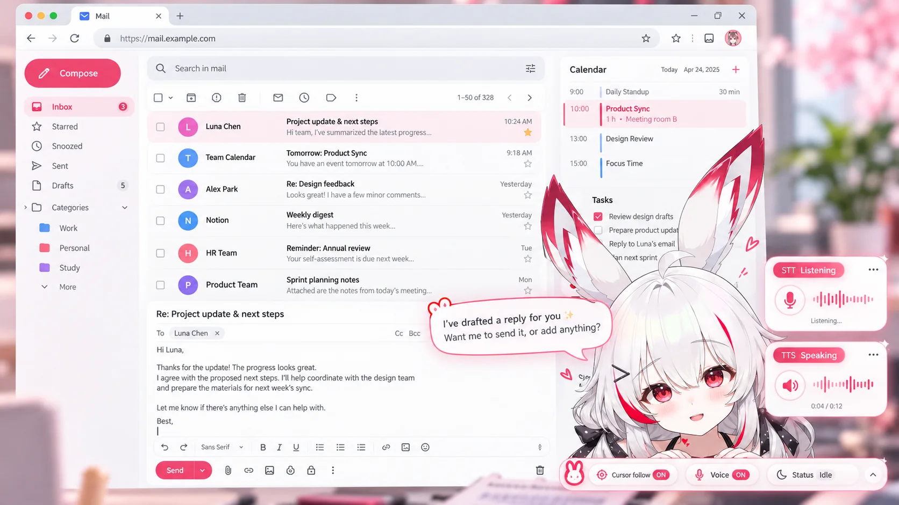
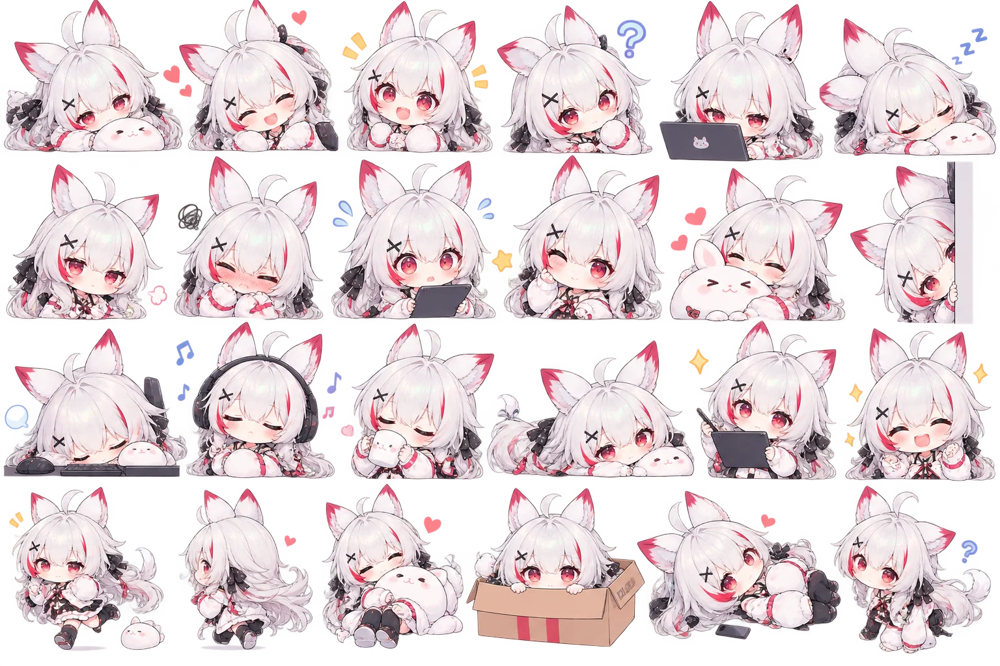

# 앱 화면 구성 (플로팅 컴패니언)

실제 사용 환경의 컨셉 이미지다. 화면 구성과 분위기를 정하는 용도이며, 이미지 속 언어(영어)와 데이터(Luna Chen 등)는 예시일 뿐이다.

## 구성 요소

| 요소 | 위치 | 내용 |
|---|---|---|
| 공유된 화면 | 전체 | 심사자가 공유한 탭. 데모에서는 가짜 메일·캘린더 화면 |
| **플로팅 캐릭터** | 오른쪽 하단 | 선택한 캐릭터(유이 또는 유미)가 화면 위에 떠 있다. 마우스 포인터를 눈으로 따라본다 |
| **말풍선** | 캐릭터 머리 왼쪽 | 캐릭터의 대사. 아래 "말풍선 디자인" 참고 |
| **STT 카드** | 오른쪽 가장자리, 컨트롤 바 위 | "Listening" 상태: 마이크 아이콘, 파형, "Listening…". 듣는 동안에만 나타난다 |
| **TTS 카드** | STT 카드 아래 | "Speaking" 상태: 스피커 아이콘, 파형, 진행 시간(예: 0:04 / 0:12). 소리가 켜져 있고 말하는 동안에만 나타난다 |
| **컨트롤 바** | 하단 오른쪽 | 마스코트 아이콘, **커서 따라가기** ON/OFF, **음성** ON/OFF, **상태**(Idle 등), 펼침 화살표 |

## 컨트롤 바

- **커서 따라가기**: 캐릭터 시선이 마우스를 따라가는 기능(US-42).
- **음성**: 소리 켜기/끄기(US-20a). 음성이 꺼져 있으면 TTS 카드는 나오지 않고 말풍선만 보인다. 음성 입력(스페이스바)과 같은 토글이 아니라, **출력 소리**의 토글이다.
- **상태**: 현재 캐릭터의 상태를 보여 준다.

  | 상태 | 의미 |
  |---|---|
  | Idle | 대기 |
  | Watching | 화면을 보는 중(공유 중). **공유 중 표시기를 이 자리에 합친다.** 점 + "공유 중" |
  | Thinking | 업무·리서치 처리 중(작업 중 애니메이션) |
  | Listening | 사용자 음성을 듣는 중 |
  | Speaking | 말하는 중 |
  | Quiet | "조용히" 모드 |

- **공유 중 표시기**는 별도 요소를 두지 않고 이 상태 영역에 둔다. 누르면 공유 중지 메뉴가 열리고, 한 번의 클릭으로 중지할 수 있어야 한다(AC-9). 컨트롤 바가 오른쪽 하단이므로 이전 결정(오른쪽 하단)과 같은 위치다.
- 펼침 화살표로 바를 접거나 펼쳐 화면을 덜 가린다. 접었을 때도 공유 중 표시는 보여야 한다.
- 캐릭터 전환 버튼과 "조용히" 버튼도 이 바에서 연다(`user-flow.md` S3).

## 말풍선 디자인

- **흰 바탕**, 테두리에 **그라데이션을 쓰지 않는다.** 단색 외곽선만 쓴다.
- 캐릭터마다 외곽선 색이 다르다.

  | 캐릭터 | 외곽선 | 제안값 |
  |---|---|---|
  | 유미 | **빨강** | #E0314B (캐릭터의 빨간 포인트색) |
  | 유이 | **핑크** | #FF8FB8 |

  색 값은 제안이며 디자인에서 확정한다.
- 말풍선 모서리에 해당 캐릭터의 **SD(치비) 이미지**를 걸쳐 둔다. SD는 감정에 맞는 것으로 바꾼다(기쁨, 졸림, 난처 등).
- 말풍선 꼬리는 캐릭터 쪽을 향한다.
- 글자는 짙은 색(흰 바탕 위 대비 확보), 한두 문장으로 짧게.

## SD(치비) 이미지

- **유미**: 치비 스티커 시트(24포즈)가 이미 있다. 감정별 포즈를 골라 말풍선 SD로 쓴다. 배경이 회색 블러라서 **개별 컷아웃(배경 제거)**이 필요하다. 시트의 머리핀은 "X" 모양인데 Live2D 모델은 ">" 모양이라, 둘을 나란히 쓸 때 어색하지 않은지 확인한다.

  
- **유이**: SD 이미지는 유빈님이 제작할 예정이다. 유미와 같은 감정 구성을 목표로 한다.
- 감정 라벨(happy, shy, sorry, troubled, surprised, thinking, playful, sleepy, neutral)별로 최소 1장씩 필요하다. 모자라면 가장 가까운 감정의 SD를 쓴다.

## 컨셉 이미지와 다르게 가야 하는 부분

1. **발송 문구**: 이미지의 말풍선은 "Want me to send it?"이라고 묻는다. 우리는 **발송하지 않는다.** 대사는 "초안 써 놨어. 고치거나 더 넣을 거 있어?"처럼 바꾼다(AC-6, AC-13).
2. **가짜 메일 화면의 Send 버튼**: 이미지의 메일 화면에는 Send 버튼이 있다. 이 화면은 우리가 만든 데모용이며, 누르면 아무것도 보내지 않고 "데모에서는 보내지 않아요"라고 알려 주거나 버튼을 비활성으로 둔다. 안심 설계 설명과 어긋나 보이지 않게 한다.
3. **언어와 데이터**: 이미지는 영어 UI다. 데모는 한국어 UI에 일본어·중국어·한국어 메일로 구성한다(`spec.md`).
4. **캘린더의 Product Sync**: 시드 데이터에 겹치는 일정이 필요하다(충돌 경고 장면).
5. **캐릭터가 화면을 가리는 정도**: 이미지에서는 캐릭터가 할 일 목록 일부를 가린다. 공유된 화면의 핵심 영역(메일 본문)은 가리지 않도록 위치와 크기를 조정한다.

## 필요한 에셋

- [ ] 유미 SD 컷아웃(감정별)
- [ ] 유이 SD(감정별), 유이 소개 이미지(랜딩용)
- [ ] 컨트롤 바 마스코트 아이콘
- [ ] STT/TTS 카드 파형 아이콘
- [ ] 말풍선 외곽선 색 확정(유미 빨강, 유이 핑크)
