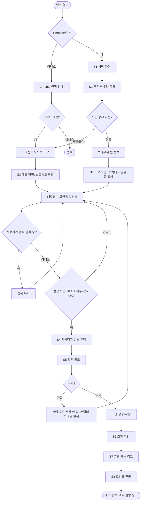

# User Flow와 화면 흐름

GitHub에서 Mermaid 다이어그램으로 렌더링된다. 화면 배치는 하정님이 디자인에서 조정하는 **제안**이다.

## 1. 메인 사용자 흐름 (리뷰어)



### 대안 흐름

| 상황 | 흐름 |
|---|---|
| 비Chrome | 안내 후 계속하면 스크립트 모드 |
| 화면 공유 거절·불가 | 스크립트 모드 자동 전환, 사용자에게 알림 한 줄 |
| 공유 중 표시기를 눌러 중지 | 공유 종료 → 스크립트 모드로 계속할지 선택 |
| 마이크 거부 | 음성 기능만 비활성, 나머지는 정상 |
| 잡담·심심해서 호출 | Sonnet·Opus 호출 없이 미리 만든 애니메이션 + Haiku가 쓴 짧은 대사 재생(소리 켜짐이면 TTS로 읽음) |
| 업무인지 애매한 요청 | 업무로 처리(오분류 방지) |
| 리서치 요청 | Haiku가 수준 판단 → Sonnet이 웹검색 → 작업 중 애니메이션 + 진행 표시(검색 중·읽는 중·정리 중) → 결과 카드(요약 + 출처 링크). 취소 가능, 상한에 닿으면 지금까지 내용으로 정리 |
| 소리 꺼짐 | 말풍선 텍스트만 표시, 음성 합성은 호출하지 않음 |
| 음성 재생 차단·실패 | 자동으로 텍스트만 표시 |
| AI·음성 호출 실패 | 준비된 대사로 이어가고 에러 화면에서 멈추지 않음 |
| 하루 3회 초과·10분 이내 | 말을 걸지 않음 (사용자가 직접 호출하면 응답) |
| 사용자가 "조용히" | 해제할 때까지 침묵 |
| 사용자가 스페이스바로 호출 | 눈치 게이트와 무관하게 즉시 응답 |

## 2. 화면 목록

| ID | 화면 | 목적 | 핵심 요소 | 다음 |
|---|---|---|---|---|
| S0 | 브라우저 안내 | 비Chrome 이탈 방지 | "Chrome에서 열어 주세요", 계속하기 | S1 |
| S1 | 시작 화면 | 첫인상, 한 줄 설명 | 캐릭터 인사, 한 줄 설명, **소리 켜기/끄기 선택**, 시작 버튼, 가공 데이터·AIRI 기반 표기 | S2 |
| S2 | 공유 안내·동의 | 신뢰 확보 | 고른 탭 하나만 본다 / 저장하지 않는다 / 언제든 끌 수 있다, 공유 시작 버튼, 공유 없이 체험 버튼 | 브라우저 탭 선택 → S3 |
| S3 | 데모 화면 | 핵심 체험 | 데모 메일 화면, 캐릭터, **오른쪽 하단 공유 중 표시기**, 마이크 버튼, 소리 토글, 조용히 버튼 | S4 |
| S4 | 말 걸기 | 눈치 순간 | 캐릭터 말풍선(음성 포함) | S5 |
| S5 | 확인 카드 | 안전 장치 | 무엇을 할지, 톤 선택(정중/간결), 수락·거절 | S6 또는 S3 |
| S6 | 초안 작업 패널 | 함께 편집하고 결과 확인 | 초안 본문(직접 편집, 선택해서 AI 수정 지시), 대상 서비스 선택(메일·Slack·Discord·Notion), 변경 표시, 되돌리기, [복사]·[저장]·[열기], "발송은 네가 직접 해" | S7 |
| S7 | 일정 충돌 경고 | 두 번째 가치 | 겹치는 두 일정 표시, 캐릭터 경고 | S8 |
| S8 | 호감도 연출 | 마무리 | 호감도 상승, 해금될 의상 예고, 설명·덱 링크 | 종료 |

## 3. 데모 화면(S3) 배치 제안

```
┌──────────────────────────────────────────────────────┐
│ [데모 메일 화면 - 가공된 데이터]            [조용히] [🎤] │
│                                                      │
│  받은편지함 | 본문(일본어 메일)                        │
│                                                      │
│                                                      │
│  ┌───────────┐                                       │
│  │ 확인 카드  │  (캐릭터 위쪽, 메일 본문을 가리지 않게)  │
│  └───────────┘                                       │
│  🧑 캐릭터 (왼쪽 하단)                                 │
│                                          ● 공유 중 ▾  │ ← 오른쪽 하단 표시기
└──────────────────────────────────────────────────────┘
```

- 캐릭터는 **왼쪽 하단**, 공유 중 표시기는 **오른쪽 하단**으로 겹치지 않게 둔다.
- 확인 카드는 캐릭터 위쪽에 띄우고 메일 본문을 가리지 않는 크기로 한다.
- 표시기는 작게, 누르면 "공유 중지" 메뉴가 열린다. 한 번의 클릭으로 중지 가능해야 한다.

## 4. 상태 목록 (화면별)

| 화면 | 상태 |
|---|---|
| S2 | 대기 / 브라우저 선택 창 열림 / 거절됨 / 불가 |
| S3 | 공유 중 / 스크립트 모드 / 공유 중지됨 / 조용히 / 입력 중 / 소리 켜짐 / 소리 꺼짐 |
| S4 | 말하는 중(소리 켜짐: 음성 + 텍스트) / 텍스트만(소리 꺼짐 또는 음성 실패) |
| S5 | 대기 / 수락 처리 중 / 수락됨 / 거절됨 / 실패(재시도 또는 폴백) |
| S6 | 작성 중(캐릭터 작업 애니메이션) / 편집 중 / AI 수정 중 / 저장됨 / 복사됨 / 실패(재시도) |
| 캐릭터 감정 | neutral · happy · thinking · surprised · sorry · focused (장면별 매핑은 별도 대사 문서에서 정의) |

## 5. 구현 메모 (간단)

- 화면 공유는 브라우저 표준 API로 탭 하나를 받고, 화면이 안 바뀐 시간은 브라우저에서 계산한다. AI는 말을 걸 만할 때만 호출한다.
- 스크립트 모드는 같은 UI에서 장면 데이터만 고정값으로 바꿔 돌리는 방식이다. 실제 공유 모드와 UI 차이를 두지 않는다.
- 쓰기 동작(초안 저장)은 확인 카드를 거치는 단일 경로로만 만든다.
- 세부 구현·분해·순서는 개발 쪽이 애자일하게 정한다.

## 6. 다음 단계

1. 데모 시나리오 원고(일본어·중국어·한국어 메일, 일정, 캐릭터 대사)
2. 눈치 판단 규칙표
3. 이 문서를 기준으로 하정님의 UI 시안
