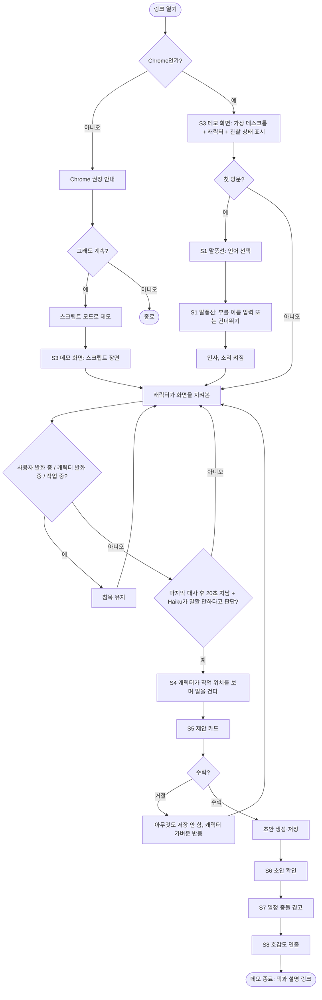

# User Flow와 화면 흐름

GitHub에서 Mermaid 다이어그램으로 렌더링된다. 화면 배치는 하정님이 디자인에서 조정하는 **제안**이다.

## 1. 메인 사용자 흐름 (리뷰어)



### 대안 흐름

| 상황 | 흐름 |
|---|---|
| 비Chrome | 안내 후 계속하면 스크립트 모드 |
| 관찰 일시정지(트레이 메뉴 또는 컨트롤 필) | 캡처와 Haiku 호출을 멈추고, 다시 누르면 재개 |
| 마이크 거부 | 음성 기능만 비활성, 나머지는 정상 |
| 잡담·심심해서 호출 | 작업 모델 호출 없이 Haiku의 `react`로 표정·모션과 짧은 대사를 보여 준다(소리가 켜져 있으면 음성도) |
| 업무인지 애매한 요청 | 업무로 처리(오분류 방지) |
| 리서치 요청 | Haiku가 수준 판단 → 작업 모델이 웹검색 → 작업 중 애니메이션 + 진행 표시(검색 중·읽는 중·정리 중) → 결과 카드(요약 + 출처 링크). 취소 가능, 상한에 닿으면 지금까지 내용으로 정리 |
| 소리 꺼짐 | 말풍선 텍스트만 표시, 음성 합성은 호출하지 않음 |
| 음성 재생 차단·실패 | 자동으로 텍스트만 표시 |
| AI·음성 호출 실패 | 준비된 대사(내장 음성 클립)로 이어가고 에러 화면에서 멈추지 않음 |
| 마지막 대사 후 20초 이내 | 먼저 말을 걸지 않음 (사용자가 직접 호출하면 응답) |
| 사용자가 "조용히" | 해제할 때까지 침묵 |
| 사용자가 누르고 말하기(기본 Space, 설정에서 변경)·VAD·채팅으로 호출 | 눈치 게이트와 무관하게 즉시 응답 |
| 발송·게시·삭제 요청 | 권한 단계에 따라 확인 카드(받는 사람·본문 등 실행될 내용 그대로)를 수락해야 실행. 거절하면 아무것도 하지 않음 |

## 2. 화면 목록

| ID | 화면 | 목적 | 핵심 요소 | 다음 |
|---|---|---|---|---|
| S0 | 브라우저 안내 | 비Chrome 이탈 방지 | "Chrome에서 열어 주세요", 계속하기 | S3 |
| S1 | 첫 방문 환영(말풍선) | 첫인상, 언어·호칭 정하기 | 캐릭터 말풍선 안에서 언어 선택(브라우저 언어 미리 선택) → 부를 이름 입력(Enter) 또는 건너뛰기. Enter가 오디오 잠금을 풀고 인사가 소리로 재생된다. 이름은 Settings > General에서 바꾼다 | S3 |
| S3 | 데모 화면 | 핵심 체험 | 가상 데스크톱(데모 메일 등), 캐릭터, **캐릭터 아래 컨트롤 필**(누르고 말하기, VAD, 화면 보기, 소리, 설정, 채팅 입력), **메뉴 막대 트레이**(관찰 상태·일시정지, 모드, 표시 언어, 소리, VAD, 설정·대시보드) | S4 |
| S4 | 말 걸기 | 눈치 순간 | 사용자의 작업 위치를 향한 시선, 캐릭터 말풍선(음성 포함) | S5 |
| S5 | 제안·확인 카드 | 안전 장치 | 제안 카드: 화면을 보고 먼저 제안한 작업 한 줄, 수락·거절. 확인 카드: 실행될 도구 입력값(받는 사람, 제목, 본문, 채널, 일시), 수락·거절 | S6 또는 S3 |
| S6 | 초안 작업 패널 | 함께 편집하고 결과 확인 | 초안 본문(직접 편집, 선택해서 AI 수정 지시), 대상 서비스 선택(메일·Slack·Discord·Notion), 변경 표시, 되돌리기, [복사]·[저장]·[열기], "발송은 네가 직접 해" | S7 |
| S7 | 일정 충돌 경고 | 두 번째 가치 | 겹치는 두 일정 표시, 캐릭터 경고 | S8 |
| S8 | 호감도 연출 | 마무리 | 호감도 상승, 해금될 의상 예고, 설명·덱 링크 | 종료 |

## 3. 데모 화면(S3) 배치 제안

```
┌──────────────────────────────────────────────────────┐
│ 메뉴 막대                              [트레이 ● 관찰 중] │
│ [데모 메일 화면 - 가공된 데이터]                      │
│                                                      │
│  받은편지함 | 본문(일본어 메일)                        │
│                                                      │
│                                                      │
│  ┌───────────┐                                       │
│  │ 확인 카드  │  (캐릭터 위쪽, 메일 본문을 가리지 않게)  │
│  └───────────┘                                       │
│  🧑 캐릭터 (오른쪽 하단, 플로팅)                                 │
│                    [말하기][VAD][화면][소리][설정][채팅] │ ← 캐릭터 아래 컨트롤 필
└──────────────────────────────────────────────────────┘
```

- 캐릭터는 **오른쪽 하단에 플로팅**하고, 그 아래에 **컨트롤 필**이 붙는다. 관찰 상태는 가상 데스크톱 메뉴 막대의 트레이 항목에 점으로 표시한다. 말풍선은 캐릭터 머리 위에 둔다(자세한 구성은 `ui-spec.md`).
- 확인 카드는 캐릭터 위쪽에 띄우고 메일 본문을 가리지 않는 크기로 한다.
- 관찰 일시정지는 트레이 메뉴의 관찰 항목이나 컨트롤 필의 화면 보기 버튼으로 한 번의 클릭에 가능해야 한다.
- 말풍선은 흰 바탕에 단색 외곽선(유미 빨강, 유이 핑크)이고, 모서리에 해당 캐릭터의 SD 이미지가 걸린다.

## 4. 상태 목록 (화면별)

| 화면 | 상태 |
|---|---|
| S1 | 언어 선택 / 이름 입력 / 인사 |
| S3 | 관찰 중 / 스크립트 모드 / 관찰 일시정지 / 조용히 / 입력 중 / 소리 켜짐 / 소리 꺼짐 |
| S4 | 말하는 중(소리 켜짐: 음성 + 텍스트) / 텍스트만(소리 꺼짐 또는 음성 실패) |
| S5 | 대기 / 수락 처리 중 / 수락됨 / 거절됨 / 실패(재시도 또는 폴백) |
| S6 | 작성 중(캐릭터 작업 애니메이션) / 편집 중 / AI 수정 중 / 저장됨 / 복사됨 / 실패(재시도) |
| 캐릭터 감정 | neutral · happy · thinking · surprised · sorry · focused · curious (장면별 매핑은 별도 대사 문서에서 정의) |

## 5. 구현 메모 (간단)

- 화면 공유는 쓰지 않는다. 웹 데모는 페이지 안의 가상 데스크톱을, 데스크톱 앱은 실제 화면을 캡처하며, 화면이 안 바뀐 시간은 클라이언트에서 계산한다. 말을 걸지는 Haiku가 판단하고, 클라이언트 게이트는 발화 중·작업 중과 20초 간격만 막는다.
- 스크립트 모드는 같은 UI에서 장면 데이터만 고정값으로 바꿔 돌리는 방식이다. 관찰 모드와 UI 차이를 두지 않는다.
- 쓰기·발송 동작은 권한 단계에 따른 확인 카드를 거치는 단일 경로로만 만든다.
- 세부 구현·분해·순서는 개발 쪽이 애자일하게 정한다.

## 6. 다음 단계

1. 데모 시나리오 원고(일본어·중국어·한국어 메일, 일정, 캐릭터 대사)
2. 눈치 판단 규칙표
3. 이 문서를 기준으로 하정님의 UI 시안
